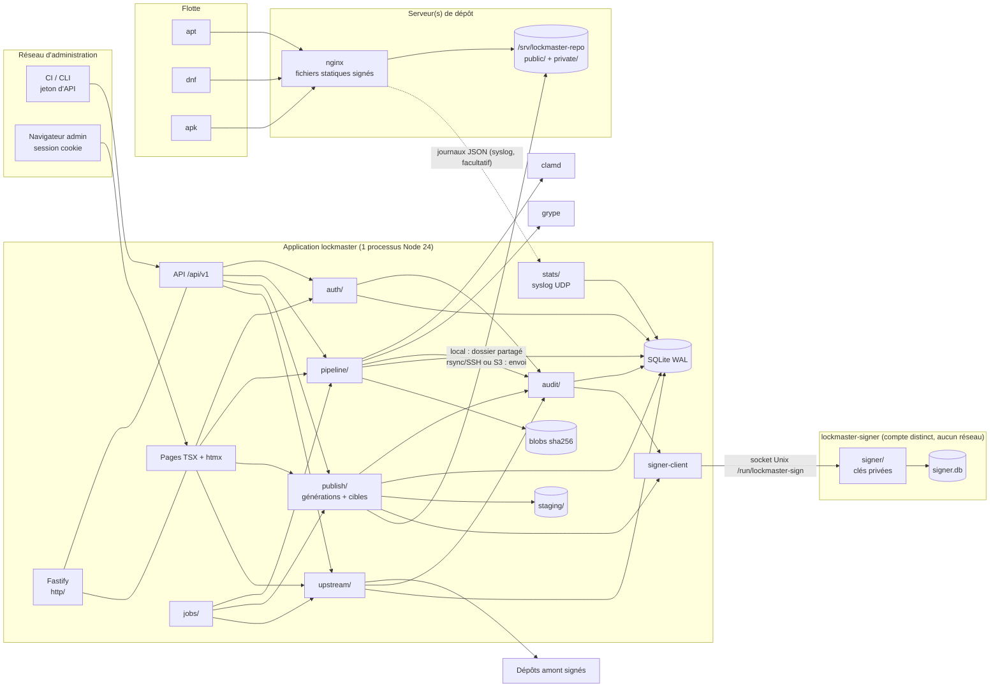

# 01 : Architecture cible

## 1. Vue d'ensemble

Deux composants (ADR-0008), l'application étant elle-même découpée en deux processus (ADR-0009) :

- **l'application `lockmaster`** : API, interface d'administration, pipeline de sécurité, publication.
  Joignable seulement par les administrateurs, la CI et la CLI (réseau interne possible). Elle fait
  signer par **`lockmaster-signer`**, processus sous un compte Linux distinct, sans réseau, seul détenteur
  des clés privées ;
- **le serveur de dépôt** : un **nginx standard** qui sert l'arborescence statique publiée par
  l'application aux clients `apt`/`dnf`/`apk`. Aucun code Lockmaster, aucune base, aucune clé privée.



Le flux réseau va de l'application **vers** le serveur de dépôt (sauf les statistiques
facultatives). Si l'application est arrêtée, les dépôts restent servis.

Choix structurants, face aux pièges de `docs/00` :

| Approche fragile | Choix retenu |
|---|---|
| plusieurs conteneurs et fichiers compose superposés | app (1 processus + signataire + clamd) et serveur de dépôt nginx ; .deb/.rpm/OCI |
| état réparti entre base serveur, JSON, index d'outils et fichiers (R1) | SQLite (vérité) + blobs immuables ; arborescence publiée dérivée |
| reprepro, createrepo_c, apk-tools, gpg, dpkg, rpm en sous-processus | génération et signature natives TS |
| fichiers modifiés en place, `pool/` complet exposé (S2, R2) | générations complètes basculées atomiquement, uniquement des paquets approuvés |
| clé privée montée dans le conteneur nginx (G4) | aucune clé sur le serveur de dépôt, signataire séparé |
| ordonnanceur en mémoire, élection de leader (R3) | file de jobs en base, un seul écrivain |
| SPA + jeton dans le navigateur (A1) | TSX serveur + cookie HttpOnly + CSRF |
| webhooks entrants avec option de désactivation de signature (A9) | rafraîchissement planifié des flux, aucun webhook entrant |
| accès SSH à l'hôte ou à la flotte (S3, R5) | absents |

## 2. Modules et responsabilités

| Module | Rôle | Dépend de |
|---|---|---|
| `config/` | charge `lockmaster.toml` + env, valide (zod), lit les `*_file` avec contrôle des permissions | - |
| `domain/` | types, machine à états, moteur de politique, identifiants | - |
| `formats/` | parse deb/rpm/apk, compare les versions, sérialise les métadonnées | `domain` |
| `crypto/` | primitives OpenPGP / RSA APK, `seal`/`unseal` (AES-GCM), scrypt, TOTP, jetons | - |
| `signer/` | **processus séparé** `lockmaster-signer` (ADR-0009) : socket Unix, contrôles par type de demande, base propre (clés chiffrées, journal de signatures chaîné), CLI locale | `crypto`, `formats` |
| `signer-client/` | client du socket ; seule façon pour l'application d'obtenir une signature | - |
| `storage/` | blobs (écriture atomique, lecture en flux), `tmp/`, `staging/`, chemins publiés validés | - |
| `db/` | connexion, migrations, accès typés par agrégat | `domain` |
| `audit/` | `record(tx, event)` chaîné, vérification, export, points de contrôle | `db`, `crypto` |
| `auth/` | utilisateurs, sessions, jetons, OIDC, MFA, `can(principal, perm, repo)` | `db`, `crypto`, `audit` |
| `scan/` | `ClamdScanner`, `GrypeScanner`, SBOM, flux KEV/EPSS | `domain`, `net` |
| `pipeline/` | ingestion -> validation -> scans -> politique -> décision -> canal | tous ci-dessus |
| `publish/` | construit une génération par canal, la vérifie, la pousse vers chaque cible (`publish/targets/{local,rsync}.ts` ; `s3.ts` après la v1), bascule, vérifie par HTTP, ramasse ; snapshots, rollback, retrait ; génère `private/` (htpasswd, marqueurs publics) | `formats`, `crypto`, `storage`, `db`, `audit`, `net` |
| `stats/` | écoute syslog UDP (désactivée par défaut), parse les journaux JSON de nginx, agrège les téléchargements | `db` |
| `upstream/` | sources, index signés, recherche, résolution de dépendances, import, miroir | `formats`, `crypto`, `net`, `pipeline` |
| `jobs/` | file persistante (`job`), workers, planification croner, SSE | `db` |
| `net/` | client HTTP sortant unique : `fetch` + garde SSRF (résolution DNS vérifiée, IP interdites), pas de redirection inter-hôtes, tailles et durées bornées | - |
| `notify/` | e-mail SMTP (nodemailer), webhooks signés | `db`, `crypto`, `net` |
| `http/` | Fastify, plugins sécurité, routes API et UI (aucun service de fichiers de dépôt) | services |
| `web/` | pages et composants TSX | services (via `http`) |
| `cli/` | commandes d'administration hors ligne | services |

`src/app.ts` construit l'objet `Deps` (config, db, signer, scanners, services) et le passe à
`http`, `jobs` et `cli`. Les tests construisent un `Deps` avec des faux.

## 3. Flux principaux

### 3.1 Upload par la CI
```
curl -T pkg.deb -H "Authorization: Bearer lkm_..." https://lockmaster/api/v1/repos/debian-bookworm/packages
-> authz pkg:upload sur debian-bookworm
-> flux vers tmp + hash -> blob -> package_version(received) + audit -> job pipeline
<- 202 { id, state: "received", links: { self, events } }
(job) validating -> scanning (clamd ‖ grype) -> décision -> approved -> channel_entry(testing)
      -> job publish (coalescé) -> génération N+1 construite et vérifiée -> poussée vers chaque cible
      -> bascule atomique -> vérification HTTP via public_url
```
La CI peut attendre : `GET /api/v1/packages/:id?wait=120` (long-poll) ou suivre le SSE.

### 3.2 Requête apt (ne touche jamais l'application)
```
GET https://repo.example.com/apt/debian-bookworm/dists/stable/InRelease
-> nginx : dépôt privé ? (absence du marqueur private/public-repos/debian-bookworm)
  -> auth_basic contre private/htpasswd/debian-bookworm.htpasswd
-> fichier statique via le lien dists/stable -> _gen/stable/000043/InRelease (Cache-Control: no-cache)
GET .../pool/main/o/openssl/openssl_3.0.11-1_amd64.deb -> fichier statique immuable (cache long)
-> ligne de journal JSON -> syslog -> application (stats/, facultatif)
```
Les `by-hash/` des K générations conservées restent disponibles dans chaque génération.

### 3.3 Import amont avec dépendances
```
UI: recherche "nginx" dans la source debian-bookworm-main (FTS sur upstream_package)
-> aperçu : résolution de la fermeture des dépendances manquantes dans le dépôt cible
-> confirmation -> job import : pour chaque paquet, téléchargement (hash attendu de l'index signé)
  -> pipeline standard (origin=import) -> rapport (importés, bloqués, en revue)
```

### 3.4 Promotion
`POST /api/v1/packages/:id/promote {to: "stable"}` -> si le canal exige une approbation :
`promotion_request(pending)` -> un autre maintainer approuve -> `channel_entry(stable)` -> publication.
Promotion par lot (toutes les versions d'un snapshot de `testing`) possible.

## 4. Concurrence

- Un seul processus. `better-sqlite3` est synchrone : les transactions sont courtes et ne
  contiennent jamais d'`await`. Helper `db.tx(fn)` qui refuse une fonction async (vérif. runtime).
- Travaux lourds : file `job` avec N workers (défaut 2 pour le pipeline, 1 pour la publication
  par canal, 1 pour les flux). Le calcul de hash et la décompression utilisent les flux Node.
- **Analyse des paquets non fiables dans un pool de `worker_threads`** (`src/pipeline/sandbox/`,
  `node:worker_threads` sans dépendance) : parsing, décompression des flux internes pour clamd et
  extraction des métadonnées tournent hors du fil principal, chaque tâche avec `resourceLimits`
  (mémoire bornée), une échéance (le worker est terminé au-delà) et aucun accès à la base ni aux
  secrets. Un paquet piégé qui épuise la mémoire ou boucle tue son worker, pas l'application : le
  paquet passe en `error` (fail-closed) et le worker est recréé. La génération des métadonnées
  publiées (jusqu'à 100 000 paquets) utilise le même pool.
- **Robustesse du processus** (conception « crash-only ») :
  - `uncaughtException` / `unhandledRejection` : journalisation puis arrêt immédiat (code non nul) ;
    systemd (`Restart=on-failure`) ou le moteur de conteneurs relance, et la reprise des jobs
    rétablit un état cohérent. Jamais de poursuite dans un état inconnu.
  - Arrêt propre sur `SIGTERM` : plus de nouvelles requêtes, jobs en cours annulés par `AbortSignal`
    et remis en file, base fermée, dans un délai borné (`TimeoutStopSec`).
  - Boucle d'événements surveillée (`perf_hooks.monitorEventLoopDelay`) : métrique dans `/metrics`,
    `/readyz` en échec au-delà d'un seuil ; aucune opération synchrone longue sur le fil principal
    (transactions SQLite courtes, travaux lourds dans le pool de workers).
  - Limites HTTP explicites : taille de corps, `requestTimeout`, `headersTimeout`, `keepAliveTimeout`,
    nombre de connexions ; upload reçu en flux vers `tmp/` avec hachage à la volée.
  - Mémoire bornée (`--max-old-space-size` dans l'unité et l'image) et file d'attente bornée.
- Au démarrage : jobs `running` -> `queued` (reprise), `tmp/` et `staging/` purgés, comparaison de
  l'état de chaque cible (`.lockmaster-target.json`) avec `target_generation` (sinon republication).

## 5. Déploiement

Voir ADR-0007 et `docs/08-exploitation.md`.

```
Application  .deb/.rpm : systemd -> lockmaster serve -> /var/lib/lockmaster ; clamd local (paquet distro)
             OCI       : compose/quadlet -> lockmaster + clamav ; volume lockmaster-data ; secret master_key
Dépôt        .deb/.rpm : paquet lockmaster-repo (sans code) -> nginx + /srv/lockmaster-repo + compte rsync restreint
             OCI       : service repo (nginx non-root, lecture seule) ; volume repo-public partagé
Même hôte : cible `local` (dossier/volume partagé).  Hôtes séparés : cible `rsync` (`s3` après la v1).
```

## 6. Principes de conception (SOLID) et règles de couches

Ces principes sont **vérifiés**, pas seulement souhaités : par les suites de conformité
(`test/contracts/`) et par `dependency-cruiser` (`.dependency-cruiser.cjs`, exécuté par `pnpm check`).

### Interfaces et implémentations

| Interface (`src/<module>/types.ts`) | Implémentations | Faux de test | Suite de conformité |
|---|---|---|---|
| `PackageFormat` (lire, valider, générer les métadonnées) | `formats/deb`, `formats/rpm`, `formats/apk` | - | `package-format.contract.ts` |
| `PublishTarget` (préparer, envoyer, basculer, vérifier, ramasser) | `targets/local.ts`, `targets/rsync.ts` (`targets/s3.ts` après la v1) | `fakes/memory-target.ts` | `publish-target.contract.ts` |
| `MalwareScanner` (analyser un flux, état de la base) | `scan/clamd.ts` | `fakes/scanner.ts` | `malware-scanner.contract.ts` |
| `VulnScanner` (SBOM -> constats) | `scan/grype.ts` | `fakes/vuln-scanner.ts` | `vuln-scanner.contract.ts` |
| `DirectoryConnector` (authentifier, résoudre les groupes, synchroniser) | `auth/oidc.ts`, `auth/ldap.ts` | `fakes/directory.ts` | `directory-connector.contract.ts` |
| `Signer` (demander une signature) | `signer-client/` | `fakes/signer.ts` | `signer.contract.ts` |
| `KeyStore` (côté signataire : stocker, déchiffrer, retirer) | `signer/keystore-file.ts` (PKCS#11 plus tard) | `fakes/keystore.ts` | `keystore.contract.ts` |
| `BlobStore` lecture / `BlobWriter` écriture | `storage/` | `fakes/blobs.ts` | `blob-store.contract.ts` |
| `Clock`, `RandomSource` | `node:*` | horloge et aléa déterministes | - |

- **S** : un module, une raison de changer. Un fichier de plus de ~400 lignes ou un service qui
  touche à plus d'un domaine se découpe.
- **O** : les variantes s'ajoutent par un registre (`formats/registry.ts`, `publish/targets/registry.ts`,
  `auth/connectors/registry.ts`) ; aucun `switch (format)` répété hors des registres.
- **L** : toute implémentation, faux compris, passe sa suite de conformité. Une suite est une fonction
  `describeXxxContract(factory)` appelée par le test de chaque implémentation.
- **I** : interfaces courtes, orientées consommateur (lire un blob et écrire un blob sont deux
  interfaces ; demander une signature et gérer les clés aussi).
- **D** : `src/app.ts` assemble l'objet `Deps` (base, horloge, aléa, scanners, cibles, connecteurs,
  client du signataire) et le passe aux services ; aucun singleton global mutable, aucun `import`
  d'infrastructure depuis `domain/` ou `formats/`.

### Règles de couches (`dependency-cruiser`)

| Interdit | Raison |
|---|---|
| `domain/`, `formats/` -> tout module d'I/O (`db/`, `net/`, `storage/`, `node:fs`, `node:net`, `node:child_process`) | cœur pur, testable sans infrastructure |
| `http/`, `web/` -> `db/` | les routes appellent des services |
| tout module sauf `signer/` -> `signer/` | ADR-0009 : l'application passe par `signer-client/` |
| `signer/` -> `net/`, `http/`, `db/` de l'application | le signataire n'a ni réseau ni accès à la base de l'application |
| `web/client/` -> tout module serveur | code navigateur isolé (ADR-0011) |
| `pipeline/sandbox/` (code des workers) -> `db/`, `crypto/`, `signer-client/`, `net/`, `config/` | le code qui touche aux paquets non fiables n'a accès ni à la base, ni aux secrets, ni au réseau |
| `publish/targets/*` -> un autre `targets/*` | cibles indépendantes |
| cycles | tous interdits |
