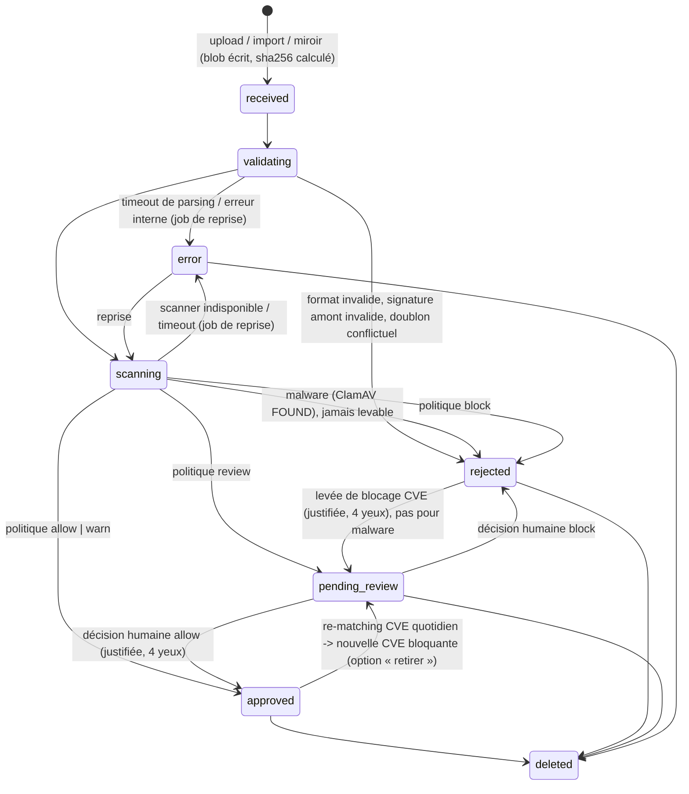

# 04 : Pipeline d'ingestion, scans, politique CVE, revue

## 1. Machine à états d'une version de paquet



- Un paquet `approved` est ajouté à son canal d'entrée (par défaut le premier canal du dépôt)
  et déclenche une publication. Les autres canaux sont atteints par **promotion**.
- Implémentation : `src/pipeline/state.ts` (table de transitions pure) +
  `src/pipeline/run.ts` (orchestration, un job par paquet, reprenable après redémarrage).
- Chaque étape écrit un `scan_run` et une entrée d'audit dans la même transaction que la transition.

## 2. Étapes

### 2.1 Réception (`src/pipeline/ingest.ts`)
- Upload : `PUT /api/v1/repos/:repo/packages` corps brut (`application/octet-stream`) ou
  multipart, en **flux** vers `data/tmp/<ulid>` en calculant sha256/sha512/sha1/md5 à la volée,
  arrêt immédiat au-delà de `max_upload_bytes`. Hash attendu optionnel
  (`X-Lockmaster-Expected-SHA256`) vérifié.
- `rename` atomique vers `blobs/` si le blob n'existe pas déjà (déduplication).
- Doublon `(repo, name, version, arch)` : même sha256 -> idempotent (200, état existant) ;
  sha256 différent -> **409** (on ne remplace jamais silencieusement une version publiée).

### 2.2 Validation (`src/pipeline/validate.ts`)
- Parseur du format (docs/03) ; format du fichier = format du dépôt ; arch acceptée par le dépôt ;
  champs obligatoires ; regex nom/version ; pour l'import amont : hash = hash de l'index signé.
- Inventaire des scripts mainteneur (noms + taille + hash ; contenu affiché à la revue,
  échappé, jamais exécuté).
- Inventaire obligatoire du contenu, pendant la lecture faite pour l'antivirus (`docs/03` §2.1) :
  setuid/setgid, périphériques, world-writable, chemins sensibles exécutés en root sans script.

### 2.3 ClamAV (`src/scan/clamd.ts`)

**ClamAV ne sait pas ouvrir les `.deb` ni les `.rpm`** (vérifié avec ClamAV 1.5.4 : un motif placé
dans le binaire ou le `postinst` d'un `.deb`, ou dans un `.rpm`, n'est pas détecté, quelle que soit la
compression ; détecté dès que le flux interne est décompressé : `docs/11` §3, SEC-01). Donc, pour
chaque paquet, Lockmaster envoie à clamd **plusieurs flux**, chacun dans sa propre session `zINSTREAM` :

| Format | Flux envoyés (décompressés en flux par Lockmaster, jamais écrits sur disque) |
|---|---|
| `.deb` | le fichier brut ; `control.tar` décompressé ; `data.tar` décompressé (gzip, xz, zstd, bzip2) |
| `.rpm` | le fichier brut ; le payload cpio décompressé (gzip, xz, zstd, bzip2) |
| `.apk` | le fichier brut ; chaque membre gzip décompressé |

- Les limites de `docs/02` §3.2 s'appliquent à la décompression (ratio, taille, mémoire du
  décodeur). Compression inconnue ou limite atteinte -> `error` (jamais « propre »). Le format lzma
  historique (`data.tar.lzma`, payload rpm `lzdio`) n'est pas pris en charge en v1 (ADR-0015).
- Le résultat est `FOUND` si **un** flux l'est ; `pass` seulement si **tous** les flux sont `OK`.
- L'artefact re-signé (mode `resign`) est lui aussi analysé avant publication (SEC-25).
- `zINSTREAM\0`, morceaux `<uint32 BE longueur><données>` <= 64 KiB, terminé par `0x00000000` ;
  réponse `stream: OK` / `stream: <Signature> FOUND` / `INSTREAM size limit exceeded` / `ERROR`.
- Taille > `max_stream_bytes` ou réponse « size limit » -> **error** (pas « propre »).
- Piège ClamAV : un fichier qui dépasse `MaxFileSize`/`MaxScanSize` de clamd revient `OK`
  **sans avoir été analysé**, sauf si `AlertExceedsMax yes` est configuré. `lockmaster doctor` et
  `/readyz` exigent `AlertExceedsMax yes` et des limites clamd >= `max_stream_bytes` (vérifiable en
  envoyant un fichier de test légèrement plus gros que la limite déclarée au démarrage).
  Une réponse `Heuristics.Limits.Exceeded... FOUND` est traitée comme **error** (paquet trop gros
  pour être analysé, refus explicite), pas comme malware ; toute autre signature `FOUND` = malware.
- Version des signatures (`zVERSION`) enregistrée dans `scan_run.db_version` ; si la base a plus
  de 48 h, l'état de santé passe à `degraded` et une notification part (politique configurable :
  `clamav_stale: block_new_uploads | warn`).

### 2.4 Analyse CVE (`src/scan/grype.ts`, `src/scan/sbom.ts`)
- SBOM CycloneDX 1.5 minimal : un composant par paquet (purl + `distro` du dépôt), plus
  le paquet source en propriété (`syft:package:metadataType` non requis ; tester ce que Grype
  attend réellement et figer le format dans des fixtures).
- `grype sbom:<fichier> -o json --by-cve --add-cpes-if-none=false` (options exactes à valider
  contre la version épinglée) ; parsing zod de la sortie ; `matches[].vulnerability` ->
  `finding` (id, sévérité, CVSS max par version, fix state/versions).
- Enrichissement : EPSS (score, percentile) et KEV depuis la base locale.
- Timeout -> `error`. Base Grype absente ou plus vieille que `max_db_age` (défaut 5 j) -> `error`
  (fail closed) sauf politique explicite `vulndb_stale: warn`.

## 3. Politique (document JSON/YAML validé par zod, versionné, audité)

```yaml
version: 1
defaults:
  verdict: allow
rules:                        # évaluées dans l'ordre, la PLUS SÉVÈRE l'emporte
  - id: kev
    when: { in_kev: true }
    verdict: block
  - id: critical-fixable
    when: { severity: [critical], fix_available: true }
    verdict: block
  - id: critical
    when: { severity: [critical] }
    verdict: review
  - id: high-exploitable
    when: { severity: [high], epss_percentile_gte: 0.9 }
    verdict: review
  - id: high
    when: { severity: [high] }
    verdict: warn
  - id: maintainer-scripts
    when: { has_maintainer_scripts: true, origin: [upload] }
    verdict: review           # activée par défaut ; désactivable par dépôt (4 yeux admin, SEC-18)
  # Règles « intégrité de la flotte » (SEC-02) : INTÉGRÉES au moteur, toujours évaluées,
  # non désactivables par le document de politique. Listées ici pour mémoire :
  #   new-name         premier upload d'un nom inconnu du dépôt                -> review
  #   protected-name   nom présent dans un index de distribution indexé       -> review (4 yeux)
  #   name-not-owned   nom hors repository.allowed_names                       -> block
  #   epoch-change     changement d'epoch par rapport à la version précédente  -> review
  #   shadowing        Obsoletes/Replaces/Provides/Conflicts/Breaks/install_if visant un nom
  #                    protégé ou appartenant à un autre dépôt                 -> review
  #   essential        Essential: yes / Protected: yes                         -> review
  #   sensitive-content setuid/setgid, périphérique, cron, apt.conf.d, sudoers.d,
  #                    ld.so.preload, règles udev, unités systemd, profile.d   -> review
  #   version-jump     version > dernière version amont connue du même nom     -> review
waivers_apply_to: [warn, review, block]   # un waiver actif neutralise la règle pour ce CVE
sla:                          # délais de traitement de la file de revue
  review_hours: 72
overrides:                    # politiques par dépôt (fusionnées sur la globale)
  repos: {}
```

Opérateurs `when` (ET logique entre clés, OU dans une liste) : `severity`, `cvss_gte`,
`epss_gte`, `epss_percentile_gte`, `in_kev`, `fix_available`, `vuln_id`, `package_name` (glob),
`origin`, `has_maintainer_scripts`, `age_days_gte` (âge de publication du CVE).

Faits supplémentaires calculés pour les règles intégrées (SEC-02) : `is_new_name`, `is_protected_name`
(nom présent dans `upstream_package` d'une source indexée pour la même distribution),
`name_allowed` (motifs `repository.allowed_names`), `epoch_changed`, `shadows` (liste des noms visés
par `Obsoletes`/`Replaces`/`Provides`/`Conflicts`/`Breaks`/`install_if`), `essential`, `has_setuid`,
`sensitive_paths` (entrées du contenu sous les chemins listés pour `sensitive-content`),
`exceeds_upstream_version`. Les paquets importés depuis un amont signé (`origin: import|mirror`)
sont exemptés de `protected-name` et `version-jump` (c'est leur nature).

Moteur : `src/domain/policy.ts`, **fonction pure** `evaluate(policy, findings, pkgFacts, waivers, now)`
-> `{ verdict, triggered: [{ruleId, vulnIds}] }`. Le verdict et la règle déclenchante sont
enregistrés dans `decision` (source `policy`) et affichés dans l'UI.

Verdicts : `allow` (publié), `warn` (publié + bannière + notification), `review`
(file de revue), `block` (rejeté, levable par un humain avec justification + 4 yeux).
Malware : rejet **non levable** (seule action : suppression).

## 4. File de revue

- Page « Revue » : paquets `pending_review` triés par ancienneté/criticité, avec findings, KEV,
  EPSS, scripts mainteneur, diff avec la version précédente (champs de contrôle, dépendances,
  scripts), SLA restant.
- Décision : `allow` ou `block` + **justification obligatoire** (>= 20 caractères) ;
  option « créer un waiver » (CVE + périmètre + **date d'expiration obligatoire** <= 1 an).
- 4 yeux : celui qui a uploadé/demandé ne peut pas approuver ; trigger SQL `decision_four_eyes`
  et CHECK de `promotion_request` (`docs/05`) + vérification applicative + tests.
- SLA : notification quand un paquet dépasse `review_hours`.

## 5. Re-matching quotidien

Job `cve.rematch` (après la mise à jour des bases) : pour chaque paquet `approved`, réanalyse du
SBOM stocké (rapide, aucun binaire relu), mise à jour des findings, réévaluation de la politique.
Si le verdict devient plus sévère :
- `notify` (défaut) : notification + bannière, le paquet reste publié ;
- `retire` (option par dépôt) : retrait du canal (nouvelle génération), **suppression immédiate du
  fichier sur toutes les cibles** de publication, générations et snapshots qui le contenaient marqués
  `purged` (ADR-0003), puis `pending_review`. Toujours appliqué pour un malware détecté après coup.
Un rapport « nouveaux CVE dans le catalogue publié » est disponible dans l'UI et par e-mail.

## 6. Mises à jour des bases

Job `feeds.refresh` planifié (défaut 03:00, configurable) : `grype db update` (ou import
hors-ligne), KEV (JSON CISA, validé par zod, remplacement atomique de la table), EPSS (CSV gzip,
~300 000 lignes, insertion par lots dans une table temporaire puis swap), état ClamAV (freshclam est
géré par le conteneur/paquet ClamAV, Lockmaster ne fait que vérifier l'âge). Échec -> notification,
anciennes données conservées.
