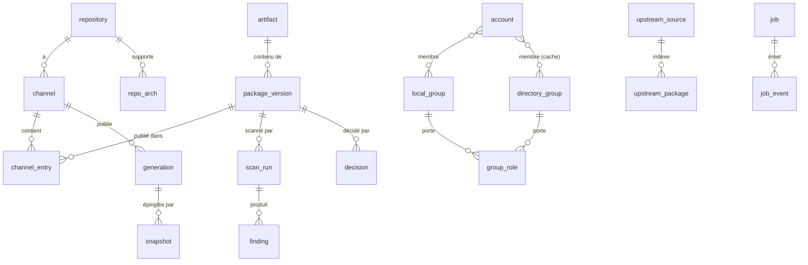

# 05 : Modèle de données (SQLite)

Conventions : voir ADR-0002. Identifiants `TEXT` = ULID (triables, générés par `src/domain/id.ts`).
Horodatages `INTEGER` ms UTC. Ce schéma est la cible de la migration `0001_init.sql` ;
les jalons suivants ajoutent des migrations, ils ne modifient jamais `0001`.

## Vue d'ensemble



## Tables

```sql
-- ─── Stockage ────────────────────────────────────────────────────────────
CREATE TABLE artifact (            -- un fichier binaire unique (blob)
  sha256      TEXT PRIMARY KEY CHECK (length(sha256) = 64),
  sha512      TEXT NOT NULL,
  sha1        TEXT NOT NULL,
  md5         TEXT NOT NULL,
  size        INTEGER NOT NULL CHECK (size > 0),
  format      TEXT NOT NULL CHECK (format IN ('deb','rpm','apk')),
  created_at  INTEGER NOT NULL,
  derived_from TEXT REFERENCES artifact(sha256)   -- paquet re-signé -> original
);

-- ─── Dépôts ──────────────────────────────────────────────────────────────
CREATE TABLE repository (
  id          TEXT PRIMARY KEY,
  name        TEXT NOT NULL UNIQUE CHECK (length(name) BETWEEN 1 AND 64 AND name GLOB '[a-z0-9]*' AND name NOT GLOB '*[^a-z0-9.-]*' AND name NOT LIKE '%..%'),
  format      TEXT NOT NULL CHECK (format IN ('deb','rpm','apk')),
  distro      TEXT NOT NULL,          -- identifiant SBOM : debian-12, rocky-9, alpine-3.20
  codename    TEXT,                   -- APT : bookworm
  components  TEXT NOT NULL DEFAULT '["main"]' CHECK (json_valid(components)),
  sign_mode   TEXT NOT NULL DEFAULT 'resign' CHECK (sign_mode IN ('preserve','resign')),
  signing_key_id TEXT REFERENCES signing_key(id),
  require_auth INTEGER NOT NULL DEFAULT 1 CHECK (require_auth IN (0,1)),   -- privé par défaut
  allowed_names TEXT NOT NULL DEFAULT '[]' CHECK (json_valid(allowed_names)), -- motifs glob des noms que ce dépôt possède (SEC-02) ; [] = aucun upload accepté avant configuration
  origin_label TEXT NOT NULL,             -- Origin/Label uniques publiés dans Release, pour l'épinglage client (SEC-05)
  policy_id   TEXT REFERENCES policy(id),   -- NULL = politique globale
  created_at  INTEGER NOT NULL
);
CREATE TABLE repo_arch (repo_id TEXT NOT NULL REFERENCES repository(id) ON DELETE CASCADE,
                        arch TEXT NOT NULL, PRIMARY KEY (repo_id, arch));
CREATE TABLE channel (             -- testing, stable...
  id          TEXT PRIMARY KEY,
  repo_id     TEXT NOT NULL REFERENCES repository(id) ON DELETE CASCADE,
  name        TEXT NOT NULL CHECK (length(name) BETWEEN 1 AND 32 AND name GLOB '[a-z0-9]*' AND name NOT GLOB '*[^a-z0-9-]*'),
  promote_from TEXT REFERENCES channel(id),       -- canal source autorisé pour la promotion
  approval_required INTEGER NOT NULL DEFAULT 0,
  retain_versions INTEGER NOT NULL DEFAULT 5,     -- versions conservées par (nom, arch)
  current_generation INTEGER,
  UNIQUE (repo_id, name)
);

-- ─── Paquets ─────────────────────────────────────────────────────────────
CREATE TABLE package_version (     -- une version d'un paquet dans un dépôt
  id          TEXT PRIMARY KEY,
  repo_id     TEXT NOT NULL REFERENCES repository(id) ON DELETE RESTRICT,
  artifact    TEXT NOT NULL REFERENCES artifact(sha256),
  name        TEXT NOT NULL,
  version     TEXT NOT NULL,
  arch        TEXT NOT NULL,
  source_name TEXT, source_version TEXT,
  metadata    TEXT NOT NULL CHECK (json_valid(metadata)),  -- champs de contrôle nécessaires à la publication
  files       TEXT CHECK (files IS NULL OR json_valid(files)),  -- RPM filelists
  state       TEXT NOT NULL CHECK (state IN
              ('received','validating','scanning','pending_review','approved','rejected','error','deleted')),
  origin      TEXT NOT NULL CHECK (origin IN ('upload','import','mirror')),
  upstream_source_id TEXT REFERENCES upstream_source(id),
  uploaded_by TEXT REFERENCES account(id),
  created_at  INTEGER NOT NULL,
  updated_at  INTEGER NOT NULL,
  UNIQUE (repo_id, name, version, arch)
);
CREATE INDEX package_version_state ON package_version(state);
CREATE INDEX package_version_name  ON package_version(repo_id, name);
CREATE TABLE package_relation (   -- dépendances normalisées (pour la résolution et l'affichage)
  package_id TEXT NOT NULL REFERENCES package_version(id) ON DELETE CASCADE,
  kind  TEXT NOT NULL CHECK (kind IN ('depends','pre_depends','recommends','provides','conflicts','obsoletes','replaces','breaks')),
  alt_group INTEGER NOT NULL,      -- alternatives « a | b » partagent le même groupe
  name  TEXT NOT NULL, op TEXT, version TEXT
);
CREATE TABLE channel_entry (       -- présence d'une version dans un canal
  channel_id TEXT NOT NULL REFERENCES channel(id) ON DELETE CASCADE,
  package_id TEXT NOT NULL REFERENCES package_version(id),
  added_at   INTEGER NOT NULL,
  added_by   TEXT,
  PRIMARY KEY (channel_id, package_id)
);

-- ─── Scans et décisions ─────────────────────────────────────────────────
CREATE TABLE scan_run (
  id          TEXT PRIMARY KEY,
  package_id  TEXT NOT NULL REFERENCES package_version(id) ON DELETE CASCADE,
  scanner     TEXT NOT NULL CHECK (scanner IN ('format','clamav','grype','policy')),
  scanner_version TEXT, db_version TEXT,
  status      TEXT NOT NULL CHECK (status IN ('running','pass','fail','error','timeout')),
  summary     TEXT NOT NULL DEFAULT '{}' CHECK (json_valid(summary)),
  started_at  INTEGER NOT NULL, finished_at INTEGER
);
CREATE TABLE finding (
  id          INTEGER PRIMARY KEY,
  scan_run_id TEXT NOT NULL REFERENCES scan_run(id) ON DELETE CASCADE,
  package_id  TEXT NOT NULL REFERENCES package_version(id) ON DELETE CASCADE,
  vuln_id     TEXT NOT NULL,          -- CVE-..., GHSA-..., ALSA-..., ou signature ClamAV
  severity    TEXT NOT NULL CHECK (severity IN ('unknown','negligible','low','medium','high','critical')),
  cvss        REAL, epss REAL, epss_percentile REAL,
  in_kev      INTEGER NOT NULL DEFAULT 0,
  fix_state   TEXT, fix_versions TEXT,
  first_seen  INTEGER NOT NULL
);
CREATE INDEX finding_pkg ON finding(package_id);
CREATE INDEX finding_vuln ON finding(vuln_id);
CREATE TABLE decision (            -- décisions de politique ET humaines, append-only
  id          TEXT PRIMARY KEY,
  package_id  TEXT NOT NULL REFERENCES package_version(id) ON DELETE CASCADE,
  verdict     TEXT NOT NULL CHECK (verdict IN ('allow','warn','review','block')),
  source      TEXT NOT NULL CHECK (source IN ('policy','human')),
  rule_id     TEXT,                   -- règle de politique déclenchante
  actor       TEXT,                   -- user id si humain
  reason      TEXT NOT NULL,          -- justification obligatoire pour une décision humaine
  created_at  INTEGER NOT NULL
);
-- Principe des 4 yeux sur les décisions humaines « allow » (levée de blocage, revue).
-- Désactivable uniquement par le réglage audité review.allow_self_approval (instance mono-utilisateur).
CREATE TRIGGER decision_four_eyes BEFORE INSERT ON decision
  WHEN NEW.source = 'human' AND NEW.verdict IN ('allow','warn')
   AND NEW.actor = (SELECT uploaded_by FROM package_version WHERE id = NEW.package_id)
   AND (SELECT value FROM setting WHERE key = 'review.allow_self_approval') IS NOT '1'
  BEGIN SELECT RAISE(ABORT, 'four-eyes: uploader cannot approve own package'); END;
CREATE TRIGGER decision_append_only_u BEFORE UPDATE ON decision BEGIN SELECT RAISE(ABORT, 'decision is append-only'); END;
CREATE TRIGGER decision_human_reason BEFORE INSERT ON decision
  WHEN NEW.source = 'human' AND (NEW.actor IS NULL OR length(trim(NEW.reason)) < 20)
  BEGIN SELECT RAISE(ABORT, 'human decision requires actor and reason (>= 20 chars)'); END;
CREATE TABLE waiver (              -- exception motivée et datée sur une vulnérabilité
  id          TEXT PRIMARY KEY,
  vuln_id     TEXT NOT NULL,
  package_name TEXT,                  -- NULL = toutes
  repo_id     TEXT REFERENCES repository(id),
  reason      TEXT NOT NULL,
  created_by  TEXT NOT NULL REFERENCES account(id),
  expires_at  INTEGER NOT NULL,       -- obligatoire : pas d'exception éternelle
  revoked_at  INTEGER
);
CREATE TABLE policy (
  id          TEXT PRIMARY KEY,
  name        TEXT NOT NULL UNIQUE,
  document    TEXT NOT NULL CHECK (json_valid(document)),  -- validé par zod (docs/04)
  version     INTEGER NOT NULL,
  updated_at  INTEGER NOT NULL, updated_by TEXT
);

-- ─── Flux de sécurité ───────────────────────────────────────────────────
CREATE TABLE kev (cve_id TEXT PRIMARY KEY, date_added TEXT, due_date TEXT, ransomware INTEGER);
CREATE TABLE epss (cve_id TEXT PRIMARY KEY, score REAL NOT NULL, percentile REAL NOT NULL);
CREATE TABLE feed_state (name TEXT PRIMARY KEY, version TEXT, fetched_at INTEGER, sha256 TEXT);

-- ─── Publication ────────────────────────────────────────────────────────
CREATE TABLE generation (
  channel_id  TEXT NOT NULL REFERENCES channel(id) ON DELETE CASCADE,
  number      INTEGER NOT NULL,
  created_at  INTEGER NOT NULL,
  key_fingerprint TEXT NOT NULL,
  package_count INTEGER NOT NULL,
  manifest_sha256 TEXT NOT NULL,      -- hash de la liste triée des sha256 publiés
  state       TEXT NOT NULL DEFAULT 'built' CHECK (state IN ('built','active','retained','purged')),
  PRIMARY KEY (channel_id, number)
);
CREATE TABLE generation_entry (    -- fichiers de paquets d'une génération : chemin public -> blob
                                   -- (envoi vers les cibles, non-écrasement, ramassage)
  channel_id TEXT NOT NULL, number INTEGER NOT NULL,
  path       TEXT NOT NULL,           -- relatif à public/ : apt/debian-bookworm/pool/main/o/openssl/openssl_3.0.11-1_amd64.deb
  artifact   TEXT NOT NULL REFERENCES artifact(sha256),
  PRIMARY KEY (channel_id, number, path),
  FOREIGN KEY (channel_id, number) REFERENCES generation(channel_id, number) ON DELETE CASCADE
);
CREATE TABLE snapshot (
  id TEXT PRIMARY KEY, channel_id TEXT NOT NULL, number INTEGER NOT NULL,
  name TEXT NOT NULL, created_by TEXT NOT NULL, created_at INTEGER NOT NULL,
  UNIQUE (channel_id, name)
);
-- État de chaque génération sur chaque cible de publication ([[publish.targets]] de lockmaster.toml,
-- identifiées par leur nom ; une cible retirée de la config garde son historique).
CREATE TABLE target_generation (
  target      TEXT NOT NULL,
  channel_id  TEXT NOT NULL,
  number      INTEGER NOT NULL,
  state       TEXT NOT NULL CHECK (state IN ('pushing','active','superseded','removed','failed')),
  pushed_at   INTEGER, activated_at INTEGER, verified_at INTEGER,
  error       TEXT,
  PRIMARY KEY (target, channel_id, number),
  FOREIGN KEY (channel_id, number) REFERENCES generation(channel_id, number) ON DELETE CASCADE
);
CREATE INDEX target_generation_active ON target_generation(target, channel_id) WHERE state = 'active';
CREATE TABLE target_file (          -- fichiers de paquets présents sur chaque cible (non-écrasement, ramassage)
  target   TEXT NOT NULL,
  path     TEXT NOT NULL,           -- chemin relatif à public/
  artifact TEXT NOT NULL REFERENCES artifact(sha256),
  pushed_at INTEGER NOT NULL,
  PRIMARY KEY (target, path)
);
CREATE TABLE signing_key (
  id          TEXT PRIMARY KEY,
  kind        TEXT NOT NULL CHECK (kind IN ('openpgp','apk-rsa')),
  purpose     TEXT NOT NULL DEFAULT 'repo' CHECK (purpose IN ('repo','audit')),  -- clé d'audit distincte (SEC-06, SEC-21)
  repo_id     TEXT REFERENCES repository(id),     -- clé par dépôt par défaut (SEC-05) ; NULL pour la clé d'audit
  fingerprint TEXT NOT NULL UNIQUE,
  public_key  TEXT NOT NULL,
  -- Aucune clé privée ici : elles n'existent que dans la base du signataire (ADR-0009, ci-dessous).
  state       TEXT NOT NULL CHECK (state IN ('active','rotating_in','rotating_out','retired')),
  created_at  INTEGER NOT NULL, expires_at INTEGER
);
CREATE TABLE promotion_request (
  id TEXT PRIMARY KEY, package_id TEXT NOT NULL REFERENCES package_version(id),
  from_channel TEXT NOT NULL REFERENCES channel(id), to_channel TEXT NOT NULL REFERENCES channel(id),
  requested_by TEXT NOT NULL, requested_at INTEGER NOT NULL,
  state TEXT NOT NULL CHECK (state IN ('pending','approved','rejected','cancelled')),
  decided_by TEXT, decided_at INTEGER, reason TEXT,
  CHECK (decided_by IS NULL OR decided_by <> requested_by)   -- principe des 4 yeux
);

-- ─── Amont ──────────────────────────────────────────────────────────────
CREATE TABLE upstream_source (
  id TEXT PRIMARY KEY, name TEXT NOT NULL UNIQUE,
  format TEXT NOT NULL, base_url TEXT NOT NULL CHECK (base_url LIKE 'https://%' OR base_url LIKE 'http://%'),
  suites TEXT NOT NULL CHECK (json_valid(suites)),     -- APT : suites+components ; RPM : chemins repodata ; APK : branches/repos
  archs  TEXT NOT NULL CHECK (json_valid(archs)),
  trusted_keys TEXT NOT NULL,          -- clés publiques armurées / .rsa.pub : OBLIGATOIRE
  target_repo_id TEXT NOT NULL REFERENCES repository(id),
  mirror_filter TEXT CHECK (mirror_filter IS NULL OR json_valid(mirror_filter)),
  mirror_schedule TEXT,                -- cron, NULL = pas de miroir
  index_etag TEXT, index_sha256 TEXT, index_fetched_at INTEGER,
  enabled INTEGER NOT NULL DEFAULT 1
);
CREATE TABLE upstream_package (     -- index amont mis en cache (recherche + résolution)
  source_id TEXT NOT NULL REFERENCES upstream_source(id) ON DELETE CASCADE,
  name TEXT NOT NULL, version TEXT NOT NULL, arch TEXT NOT NULL,
  location TEXT NOT NULL, size INTEGER NOT NULL, sha256 TEXT NOT NULL,
  relations TEXT NOT NULL CHECK (json_valid(relations)),
  summary TEXT,
  PRIMARY KEY (source_id, name, version, arch)
);
CREATE VIRTUAL TABLE upstream_package_fts USING fts5(name, summary, content='upstream_package');

-- ─── Identités et accès ─────────────────────────────────────────────────
CREATE TABLE account (
  id TEXT PRIMARY KEY, username TEXT NOT NULL UNIQUE COLLATE NOCASE,
  display_name TEXT NOT NULL DEFAULT '', email TEXT NOT NULL DEFAULT '',
  password_hash TEXT,                  -- comptes locaux uniquement ; jamais d'empreinte de mot de passe AD
  auth_source TEXT NOT NULL CHECK (auth_source IN ('local','directory')),
  -- Identité d'annuaire (ADR-0010) : connecteur déclaré dans lockmaster.toml + identifiant stable
  -- (OIDC : sub de l'émetteur du connecteur ; LDAP/AD : objectGUID). Jamais de liaison par e-mail.
  directory_connector TEXT, directory_subject TEXT,
  totp_secret_enc BLOB, totp_enabled INTEGER NOT NULL DEFAULT 0, totp_last_step INTEGER,
  failed_logins INTEGER NOT NULL DEFAULT 0, locked_until INTEGER,
  disabled INTEGER NOT NULL DEFAULT 0,  -- désactivation LOCALE : prioritaire sur l'annuaire
  created_at INTEGER NOT NULL, last_login_at INTEGER,
  directory_synced_at INTEGER,          -- dernière synchronisation réussie des appartenances (max_staleness)
  elevated_at INTEGER,                  -- dernière élévation de rôle : pas de décision de revue pendant 24 h (SEC-08)
  UNIQUE (directory_connector, directory_subject),
  CHECK ((auth_source = 'directory') = (directory_connector IS NOT NULL AND directory_subject IS NOT NULL)),
  CHECK (auth_source = 'directory' OR password_hash IS NOT NULL)
);
CREATE TABLE recovery_code (user_id TEXT NOT NULL REFERENCES account(id) ON DELETE CASCADE,
  code_hash TEXT NOT NULL, used_at INTEGER, PRIMARY KEY (user_id, code_hash));
-- ─── Groupes et rôles (ADR-0010) : les rôles ne s'attribuent qu'à des groupes ───────────
CREATE TABLE local_group (
  id TEXT PRIMARY KEY, name TEXT NOT NULL UNIQUE COLLATE NOCASE,
  description TEXT NOT NULL DEFAULT '',
  break_glass INTEGER NOT NULL DEFAULT 0 CHECK (break_glass IN (0,1)),  -- groupe de secours (admins-secours)
  created_at INTEGER NOT NULL
);
CREATE TABLE local_group_member (
  group_id TEXT NOT NULL REFERENCES local_group(id) ON DELETE CASCADE,
  account_id TEXT NOT NULL REFERENCES account(id) ON DELETE CASCADE,
  added_by TEXT NOT NULL, added_at INTEGER NOT NULL,
  PRIMARY KEY (group_id, account_id)
);
CREATE TABLE directory_group (        -- groupe AD/IdP connu de l'application (pour le mapping)
  id TEXT PRIMARY KEY,
  connector TEXT NOT NULL,              -- nom du connecteur (lockmaster.toml)
  external_id TEXT NOT NULL,            -- LDAP/AD : objectGUID du groupe ; OIDC : valeur du claim
  display_name TEXT NOT NULL,           -- DN ou nom lisible, informatif seulement
  UNIQUE (connector, external_id)
);
CREATE TABLE account_directory_group (  -- appartenances en cache, datées (continuité si l'AD tombe)
  account_id TEXT NOT NULL REFERENCES account(id) ON DELETE CASCADE,
  directory_group_id TEXT NOT NULL REFERENCES directory_group(id) ON DELETE CASCADE,
  synced_at INTEGER NOT NULL,
  PRIMARY KEY (account_id, directory_group_id)
);
CREATE TABLE group_role (
  id TEXT PRIMARY KEY,
  group_kind TEXT NOT NULL CHECK (group_kind IN ('local','directory')),
  local_group_id TEXT REFERENCES local_group(id) ON DELETE CASCADE,
  directory_group_id TEXT REFERENCES directory_group(id) ON DELETE CASCADE,
  role TEXT NOT NULL CHECK (role IN ('admin','maintainer','uploader','auditor','reader')),
  repo_id TEXT REFERENCES repository(id) ON DELETE CASCADE,   -- NULL = rôle global
  created_by TEXT NOT NULL, created_at INTEGER NOT NULL,
  CHECK ((group_kind = 'local') = (local_group_id IS NOT NULL AND directory_group_id IS NULL)),
  CHECK ((group_kind = 'directory') = (directory_group_id IS NOT NULL AND local_group_id IS NULL)),
  CHECK (repo_id IS NULL OR role IN ('maintainer','uploader','reader')),  -- auditor et admin : globaux uniquement
  UNIQUE (group_kind, local_group_id, directory_group_id, role, repo_id)
);
CREATE TABLE session (
  id_hash TEXT PRIMARY KEY,            -- SHA-256 de l'identifiant de session
  user_id TEXT NOT NULL REFERENCES account(id) ON DELETE CASCADE,
  csrf_token TEXT NOT NULL, mfa_passed INTEGER NOT NULL DEFAULT 0,
  mfa_method TEXT CHECK (mfa_method IN ('totp','recovery','idp')),  -- origine de la MFA (ADR-0010 §5)
  created_at INTEGER NOT NULL, last_seen_at INTEGER NOT NULL, expires_at INTEGER NOT NULL,
  ip TEXT, user_agent TEXT,
  CHECK (mfa_passed = 0 OR mfa_method IS NOT NULL)
);
CREATE TABLE api_token (
  id TEXT PRIMARY KEY, token_hash TEXT NOT NULL UNIQUE, prefix TEXT NOT NULL,
  name TEXT NOT NULL, user_id TEXT NOT NULL REFERENCES account(id) ON DELETE CASCADE,
  scopes TEXT NOT NULL CHECK (json_valid(scopes)),   -- ex. ["pkg:upload:debian-bookworm"]
  created_at INTEGER NOT NULL, expires_at INTEGER NOT NULL, last_used_at INTEGER, revoked_at INTEGER
);
CREATE TABLE repo_credential (      -- identifiants « lecture seule » pour clients apt/dnf/apk
  id TEXT PRIMARY KEY, repo_id TEXT NOT NULL REFERENCES repository(id) ON DELETE CASCADE,
  username TEXT NOT NULL,
  secret_hash TEXT NOT NULL,           -- chaîne crypt SHA-512 « $6$... » recopiée telle quelle dans le htpasswd
                                       -- (secret aléatoire 32 o : $6$ suffit ; jamais le secret en clair)
  label TEXT,
  purpose TEXT NOT NULL DEFAULT 'client' CHECK (purpose IN ('client','verify')),  -- 'verify' : vérification HTTP par l'app
  secret_enc BLOB,                     -- seulement pour 'verify' : secret chiffré (seal) utilisé par l'app
  created_at INTEGER NOT NULL, expires_at INTEGER, revoked_at INTEGER, UNIQUE (repo_id, username),
  CHECK ((purpose = 'verify') = (secret_enc IS NOT NULL))
);
CREATE TABLE password_reset (token_hash TEXT PRIMARY KEY, user_id TEXT NOT NULL REFERENCES account(id) ON DELETE CASCADE,
  expires_at INTEGER NOT NULL, used_at INTEGER);

-- ─── Audit ──────────────────────────────────────────────────────────────
CREATE TABLE audit_event (
  seq        INTEGER PRIMARY KEY,      -- monotone
  at         INTEGER NOT NULL,
  actor      TEXT NOT NULL,            -- user id, 'token:<id>', 'system'
  ip         TEXT,
  action     TEXT NOT NULL,            -- package.upload, decision.human, key.rotate...
  target     TEXT,
  details    TEXT NOT NULL CHECK (json_valid(details)),
  prev_hash  TEXT NOT NULL,
  hash       TEXT NOT NULL             -- SHA-256(prev_hash ‖ JSON canonique de l'événement)
);
CREATE TRIGGER audit_no_update BEFORE UPDATE ON audit_event BEGIN SELECT RAISE(ABORT, 'audit is append-only'); END;
CREATE TRIGGER audit_no_delete BEFORE DELETE ON audit_event
  WHEN (SELECT value FROM setting WHERE key = 'audit.purge_in_progress') IS NOT '1'
  BEGIN SELECT RAISE(ABORT, 'audit is append-only'); END;
CREATE TABLE audit_checkpoint (seq INTEGER PRIMARY KEY, hash TEXT NOT NULL, signature TEXT NOT NULL, at INTEGER NOT NULL);

-- ─── Jobs, réglages, notifications, statistiques ───────────────────────
CREATE TABLE job (
  id TEXT PRIMARY KEY, kind TEXT NOT NULL, payload TEXT NOT NULL CHECK (json_valid(payload)),
  state TEXT NOT NULL CHECK (state IN ('queued','running','succeeded','failed','cancelled')),
  attempts INTEGER NOT NULL DEFAULT 0, run_after INTEGER NOT NULL,
  started_at INTEGER, finished_at INTEGER, error TEXT, created_by TEXT,
  dedupe_key TEXT UNIQUE                -- évite deux jobs identiques en file
);
CREATE TABLE job_event (job_id TEXT NOT NULL REFERENCES job(id) ON DELETE CASCADE,
  seq INTEGER NOT NULL, at INTEGER NOT NULL, level TEXT NOT NULL, message TEXT NOT NULL,
  progress REAL, PRIMARY KEY (job_id, seq));
CREATE TABLE setting (key TEXT PRIMARY KEY, value TEXT NOT NULL, updated_at INTEGER NOT NULL, updated_by TEXT);
CREATE TABLE notification_channel (id TEXT PRIMARY KEY, kind TEXT NOT NULL CHECK (kind IN ('email','webhook')),
  name TEXT NOT NULL, config_enc BLOB NOT NULL, events TEXT NOT NULL CHECK (json_valid(events)), enabled INTEGER NOT NULL DEFAULT 1);
CREATE TABLE download_stat (day INTEGER NOT NULL, repo_id TEXT NOT NULL, package_name TEXT NOT NULL,
  arch TEXT NOT NULL, count INTEGER NOT NULL, bytes INTEGER NOT NULL,
  PRIMARY KEY (day, repo_id, package_name, arch));
```

## Base du service de signature (`/var/lib/lockmaster-signer/signer.db`, ADR-0009)

Base SQLite **distincte**, lisible par le seul compte `lockmaster-signer`. L'application n'y a aucun accès.

```sql
CREATE TABLE key (
  id          TEXT PRIMARY KEY,                -- même identifiant que signing_key.id côté application
  kind        TEXT NOT NULL CHECK (kind IN ('openpgp','apk-rsa')),
  purpose     TEXT NOT NULL CHECK (purpose IN ('repo','audit')),
  fingerprint TEXT NOT NULL UNIQUE,
  public_key  TEXT NOT NULL,
  private_key_enc BLOB NOT NULL,               -- AES-256-GCM(clé maîtresse du SIGNATAIRE), AAD = id
  -- Identité liée à la clé, fixée à la création/rotation, modifiable seulement par la CLI locale :
  repo_name   TEXT, repo_format TEXT, origin_label TEXT,
  allowed_names TEXT NOT NULL DEFAULT '[]' CHECK (json_valid(allowed_names)),
  state       TEXT NOT NULL CHECK (state IN ('active','rotating_in','rotating_out','retired')),
  created_at  INTEGER NOT NULL, expires_at INTEGER,
  CHECK ((purpose = 'audit') = (repo_name IS NULL))
);
CREATE TABLE signature_log (                   -- journal chaîné, append-only
  seq        INTEGER PRIMARY KEY,
  at         INTEGER NOT NULL,
  key_id     TEXT NOT NULL REFERENCES key(id),
  kind       TEXT NOT NULL,                    -- apt-release, rpm-repomd, rpm-header, apk-index, apk-package, audit-checkpoint
  content_sha256 TEXT NOT NULL,
  request    TEXT NOT NULL CHECK (json_valid(request)),   -- contexte déclaré : dépôt, canal, génération, paquet
  outcome    TEXT NOT NULL CHECK (outcome IN ('signed','refused')),
  reason     TEXT,                             -- motif de refus
  prev_hash  TEXT NOT NULL,
  hash       TEXT NOT NULL
);
CREATE TRIGGER signature_log_no_update BEFORE UPDATE ON signature_log BEGIN SELECT RAISE(ABORT, 'append-only'); END;
CREATE TRIGGER signature_log_no_delete BEFORE DELETE ON signature_log BEGIN SELECT RAISE(ABORT, 'append-only'); END;
CREATE TABLE rate_window (key_id TEXT NOT NULL, minute INTEGER NOT NULL, count INTEGER NOT NULL,
  PRIMARY KEY (key_id, minute));
```

## Notes

- Les noms de dépôts et de canaux servent dans des URL et des chemins publiés : la contrainte SQL
  est une seconde barrière, la validation zod (même regex `^[a-z0-9][a-z0-9.-]*$` sans `..`)
  reste la première.
- La purge d'audit (rétention) est la **seule** suppression autorisée ; elle crée d'abord un
  `audit_checkpoint` signé par la clé OpenPGP de l'instance contenant le hash de la dernière
  entrée purgée, afin que la chaîne restante reste vérifiable.
- `download_stat` est alimenté par `src/stats/` : journaux d'accès JSON envoyés par nginx en syslog
  UDP (ADR-0008), filtrés (sources autorisées, statut 200/206, chemins de paquets uniquement),
  agrégés en mémoire et écrits toutes les 60 s. Facultatif : vide si nginx n'envoie rien.
- `repository.require_auth` et `repo_credential` pilotent ce que l'application publie dans
  `private/` sur les cibles (htpasswd, marqueur public) ; nginx applique (ADR-0008).
- Les champs `*_enc` sont chiffrés par `src/crypto/seal.ts` (AES-256-GCM, AAD = nom de table +
  colonne + clé primaire, pour empêcher le déplacement d'un chiffré vers une autre ligne).
